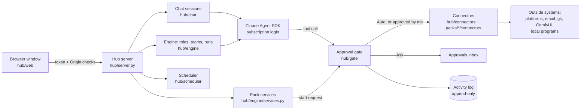
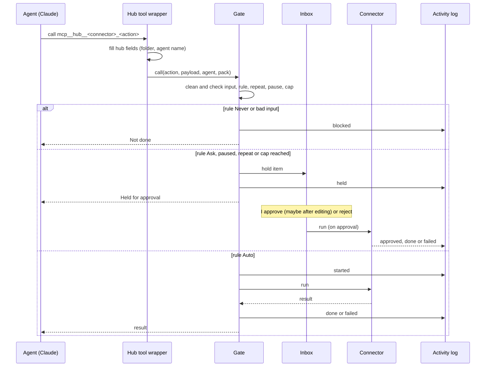

# Architecture

How the Personal AI Automation Hub is built. The requirements (what and why) are in
[REQUIREMENTS.md](REQUIREMENTS.md). This document covers how the pieces fit, so the code
can be changed safely. Requirement IDs (G-APPR-1, P-PIPE-3, ...) point back to the requirements.

## The big picture

One local server process on this PC runs everything. The browser window talks only to it.
Agents run through the Claude Agent SDK on the Claude subscription (never an API key). Every
action outside the app passes the approval gate before a connector carries it out.



## Components

| Part | Folder | What it does |
| --- | --- | --- |
| Server | `hub/server.py` | FastAPI on 127.0.0.1 only. A random token per launch (kept as an HttpOnly cookie), Host and Origin checks, strict CSP (N-SEC-1, N-SEC-4). Wires every store together at start-up. |
| Start-up checks | `hub/auth_check.py` | Removes `ANTHROPIC_API_KEY` and other billing variables, checks the subscription login (R-AUTH-1..4). |
| Chat | `hub/chat/` | One live Claude Code process for the open chat (N-PERF-3). Builds SDK options: tools allowed per role, the rest removed and denied (G-TOOL-3, N-SEC-3). History in `data/chats.db`. |
| Engine | `hub/engine/` | Roles (`roles.py`), team templates (`teams.py`), team runs (`orchestrator.py`, `runs.py`), packs (`packs.py`), pack services (`services.py`). |
| Approval gate | `hub/gate/` | Rules (Auto, Ask, Never, daily cap), the inbox, the activity log, repeat detection, crash recovery (G-APPR-1..4, G-LOG-1, N-REL-3). |
| Scheduler | `hub/scheduler/` | Time, interval, file and "after" triggers for role and team tasks. Missed runs are listed, never run by themselves (G-SCHED-1, G-SCHED-2). Also stores the notices shown in the window. |
| Connectors | `hub/connectors/`, `packs/*/connectors/` | Modules that list `ACTIONS`. Found automatically. A pack's connectors load only while the pack is on (G-TOOL-4, G-PACK-1). |
| Window | `hub/web/` | Plain HTML, CSS and JavaScript, no build step. |

## An agent's tool call



Key points:
- **Read-only actions** (`acting=False`) skip the gate. They only read or change the hub's own data.
- **Hub-filled fields** (`{"hub": "folder"}`, `{"hub": "agent"}`) are set by the hub. Whatever the agent sends for them is dropped, so an agent cannot point an action at another folder or pose as another role.
- **Pinned approvals:** a connector can show the exact text or command (`Action.show`, with `show_label`) and check that what runs is still what was shown (`Action.check`, fingerprints).
- **Crash safety:** "started" is logged before a connector runs. After a crash, unfinished calls are marked "unknown" and never re-run (N-REL-3).
- **Buttons only for me:** actions marked `ui_only` appear as row buttons on a pack's table and are never offered to a role.

## Packs

A pack is a folder in `packs/<id>/`. Installing it never changes the engine or another pack (G-PACK-2).

```
packs/<id>/
  pack.md          name, version, description, views (tables) and row_actions (my buttons)
  roles/*.md       roles: model, tools, max turns, instructions
  teams/*.md       team templates
  connectors/*.py  modules with ACTIONS (files starting with "_" are helpers, never loaded as connectors)
  rules.md         suggested approval rules (a suggested Auto is installed as Ask)
  schedules/*.md   default schedules (installed switched off)
  settings.md      settings I fill in on the Packs page (secrets go to Windows Credential Manager)
```

| Pack | Milestone | Design notes |
| --- | --- | --- |
| Routines | 9 | Plain-words routines become schedules. Actions go through the gate like any other. |
| Social media | 10 | Official APIs only. Logins in keyring. Content rules checked before anything is held. |
| Job applications | 11 | Facts only from my profile, fact check gate, Prepare only by default, a Tracker table. |
| Software team | 12 | Git in the team folder, tests in a throwaway clone, merges only after a passing test and a review by someone else. |
| Video production | 13 | ComfyUI on this PC only, templates with placeholders, one render at a time, script and final cut pinned by fingerprint. |
| Pipeline manager | 14 | A queue per channel repo on this PC. See [PIPELINE_MANAGER.md](PIPELINE_MANAGER.md). |

### Pack services (G-PACK-3)

Some work is only watching and bookkeeping, for example checking every few seconds whether a
12-hour render has finished. Running that through Claude would spend subscription tokens on
every check, so packs can offer plain code instead:

- `TICK(ctx)`: called every 15 seconds while the app is on, in a worker thread, for each switched-on pack that has it.
- `BUSY()`: returns why the pack cannot be switched off or removed right now ("" if it can).

The context gives a service only what it needs:

| `ctx.` | Purpose |
| --- | --- |
| `call(action_id, payload)` | Goes through the approval gate, logged as "&lt;pack&gt; service". A service never acts outside the app any other way. |
| `approval(item_id)` | Follow what I decided on an inbox item. |
| `withdraw(item_id, reason)` | Take back this pack's own pending request that can no longer be approved as shown (logged, never run). |
| `notify(title, text, failed)` | A notice in the window, like a finished schedule. |
| `paused()` | True while automation is paused (G-BUDGET-2): start nothing new. |

## Data and secrets

| Where | What |
| --- | --- |
| `config.json` | My settings (personality, model, theme, pause switch). Not committed. |
| `data/chats.db` | Chat history. |
| `packs/local/roles/`, `packs/local/teams/` | My own roles and team templates, one Markdown file each. |
| `data/hub.db` | Approval rules, inbox, activity log, installed packs and their settings, schedules, team runs, notices. |
| `data/pack-data/<pack>/` | A pack's own data, for example the pipeline queue and run folders. |
| `projects/` | Working folders of roles and teams. Agents work only inside these. |
| Windows Credential Manager | Platform logins (service `sapi-ai-hub`, user `<pack>/<key>`). Never in files, logs or agent context. |

`data/`, `projects/`, `config.json` and `packs/local/` are never committed.

## Security model in one table

| Threat | Guard |
| --- | --- |
| A website talks to the local server | 127.0.0.1 only, launch token cookie, Host and Origin checks, CSP |
| An agent uses a tool it should not | Allow-list plus removal plus deny rules per role, never bypass mode |
| An agent acts outside without me | Every acting tool passes the gate, new rules start as Ask, only I set Auto |
| Text on a web page or in a file steers an agent | Treated as information. The rule decides, not the agent (N-SEC-7). |
| An action runs twice after a crash | "started" logged first, repeats held, unknown outcomes never re-run |
| Secrets leak | Keyring only, shown as "(set)", never passed to an agent |
| An agent chooses what program runs | Only my pack settings name programs. Agents fill in checked values only (P-PIPE-1, P-PIPE-3). |
