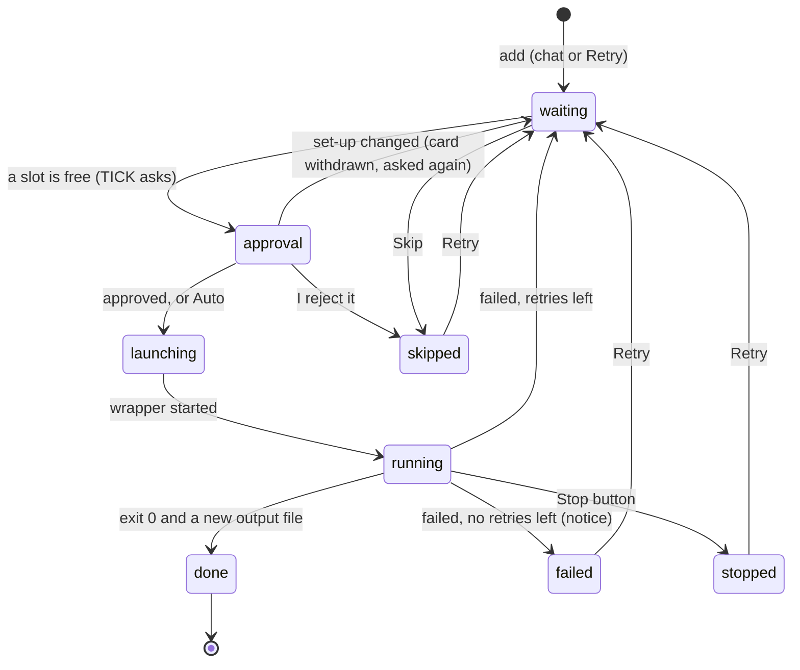
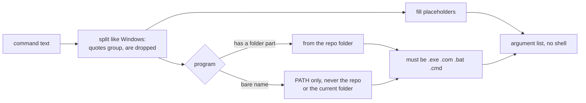
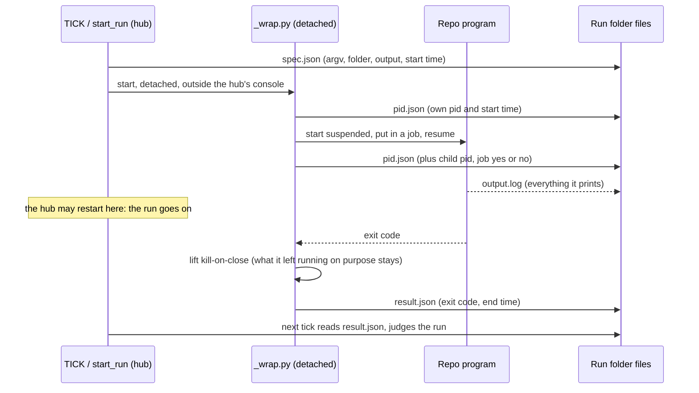

# Pipeline manager design (Milestone 14)

Requirements: P-PIPE-1..7 and G-PACK-3 in [REQUIREMENTS.md](REQUIREMENTS.md). Code:
`packs/pipeline/`. User guide: the pack's own page (`packs/pipeline/pack.md`). Platform context:
[ARCHITECTURE.md](ARCHITECTURE.md).

## The problem

Several channel repos on this PC each generate videos with their own command. Renders can take
12 hours or more, and some steps use the GPU. The hub should keep a list of videos per channel,
start each repo's pipeline (one after another, or a few at once), watch it, and start the next
one when it finishes, without spending Claude tokens on the watching.

## Design choices

| Choice | Why | Alternative not taken |
| --- | --- | --- |
| Watching is plain code (a pack service `TICK`), not Claude | Checking a run every 15 s is bookkeeping. Through Claude it would spend tokens on every check. | A schedule that asks a role every few minutes |
| Commands live only in my pack setting `channels` | Hard rule: an agent never chooses what runs. Settings are only editable on the Packs page. | A channels file in a folder (an agent with file tools could rewrite it) |
| No shell. The program is resolved to a full path, the arguments are a list | No shell metacharacter can ever run | `shell=True` with quoting |
| Each run is its own detached process through a small wrapper | A 12-hour render must survive a hub restart or close | Child processes of the hub |
| Every start goes through the approval gate, pinned to the exact command | Running a repo's code acts outside the app | A start button only (no log, no rule) |
| No default time limit, a "quiet" notice instead | Long renders are normal. A silent log is worth a look, not a kill. | A fixed 3-hour timeout |
| GPU work is one at a time across all channels | Two GPU renders on one card slow down or crash | Per-channel limits only |

## Parts

| File | Role |
| --- | --- |
| `connectors/_pstate.py` | Channel parsing and checks, item rules, command building, launching, process checks and stopping, output detection. The queue database (`data/pack-data/pipeline/queue.db`). |
| `connectors/_wrap.py` | The wrapper process: runs one item, writes `pid.json` and `result.json`. |
| `connectors/pipeline_tools.py` | Actions (the start action, role tools, Queue buttons), `TICK` and `BUSY`. |
| `roles/pipeline-manager.md` | The chat role: list channels, read the queue, add, skip, move, retry, pause, resume. It cannot start or stop a run. |
| `rules.md` | `pipeline_tools.start_run: ask cap 50`. |

## Channel set-up (P-PIPE-1)

One block per channel in the `channels` setting:

```
[reelwright]
folder: D:\repos\video-gen-ai-agent
command: .venv\Scripts\python.exe main.py --input {input}
retry_command: .venv\Scripts\python.exe main.py --input {input} --resume
output: output\**\*.mp4
gpu: yes
parallel: 1
timeout:
quiet: 2h
retries: 1
```

A channel with any problem is shown as "needs fixing" on the Queue and never starts:
an unknown key, a folder that is not a local folder, a program that does not exist, an unknown
placeholder, or an output rule broken (see "Done check" below).

## Lifecycle of one item



Columns that matter: `tries` (starts so far), `fails` (failures since added or retried by
hand), `asks` (requests so far, each its own approval), `fingerprint`, `run_dir`, `pid` and
`created` (the wrapper process and its exact start time).

## Slots (P-PIPE-4)

On each tick, while automation and the channel are not paused, the service asks for the next
waiting item of a channel when all of these hold:

- the channel has fewer items active (asking, starting or running) than its `parallel`;
- for a GPU channel, no GPU item is active anywhere (a channel that is no longer set up counts as GPU);
- fewer items are active overall than "Most runs at once" (default 3).

Only one item per free slot waits in Approvals at a time, so the inbox does not fill up. A
start that fails stops that channel for the rest of the tick, so one broken channel cannot
fail its whole queue at once.

## Approvals (P-PIPE-5)

The request is `{item, attempt, fingerprint}`:

- `attempt` is the ask number. Each ask is a new request, so a Retry after a Reject is never held as a "repeat".
- `fingerprint` covers the channel's folder, commands, output, GPU flag and time limit, plus the item number and text.

The card ("Will run exactly") shows the folder, the full program path and arguments, the done
rule, GPU and the time limit. When I approve, `start_run` checks again that the item still waits
for exactly this request and that the fingerprint still matches. If my channel set-up changed
while the card waited, the service withdraws the card and asks again.

## Building the command (P-PIPE-3)



| Placeholder | Becomes | Rules |
| --- | --- | --- |
| `{input}` | the item text | Letters, digits, spaces and `_ . @ + / \ -`, starting with a letter or digit, no `..` step, no `:`. With a .bat or .cmd program, no spaces (cmd.exe splits on them). |
| `{input_file}` | the path of a file holding the item text | Any one line up to 500 characters. The text never touches the command line. |
| `{item}` | the queue number | |

Two items whose text names the same file on Windows (`Story1` and `story1`, `a/b` and `a\b`)
count as duplicates.

## Running and surviving restarts (P-PIPE-6)



- The hub records the wrapper's process id **and** its start time, read from `pid.json`. A venv `python.exe` is only a launcher that starts the real Python as its child, so the id from starting it may not be the wrapper. Comparing the start time means a reused process id is never mistaken for the run, also after a reboot.
- If the hub stopped right after starting a run, the next tick adopts it from `pid.json` instead of starting it again.
- Files are replaced in one step (temp file, then replace), retried while the hub has them open, so neither side reads half a file.
- Each run gets its own folder (`runs/<item>-<ask>`), never reused.

### Stopping a run

Stop (and the time limit) holds a handle on the wrapper, checks its start time, then:

1. `taskkill /T /F` on the wrapper: ends every process still linked to it by parent.
2. Ends the wrapper: its job closes and ends what is left in the job, also a process whose parent already exited.

After that it reads `result.json` once more: a run that had just finished by itself is judged
normally instead of being marked stopped or failed.

**Known limit:** a venv `python.exe`, the `py` launcher and Microsoft Store Python move their
children out of the job. Below those, only step 1 reaches a process, so a helper whose parent
already exited can survive a Stop. Documented on the pack page.

## Done check (P-PIPE-2)

A run is done when **both** hold:

1. the exit code is 0;
2. a file matching the channel's `output` exists, is not empty, was written during this run, and is not another done item's file that was not rewritten since that item ended.

Otherwise it is a failure: back in line (first for its channel) while `fails <= retries`,
using `retry_command` if set, then marked failed with a notice. A retry notice is shown as a
heads-up, only the final failure as a failure.

To stop two runs claiming one file, the output pattern must give each run its own name when:

| Case | Rule |
| --- | --- |
| `parallel` above 1 | `{input}` in a pattern with no wildcard at all, or `{item}` with no wildcard before it and no digit or wildcard straight after it |
| Two channels whose output folders are the same or nested | `{item}` (the same item text can be queued in both) |

## Notices

| Event | Notice |
| --- | --- |
| A run is done | "Pipeline: &lt;channel&gt; #&lt;n&gt; done" with the output file |
| An attempt failed, a retry follows | heads-up |
| An item failed for good | failure, "it needs you" |
| A run printed nothing for `quiet` | heads-up, once (cleared when the log grows again) |
| A start was refused or could not start | failure |

## Testing

- `tests/test_pipeline.py`: fake repos (a small `make.py`, batch files) that succeed, fail,
  hang, leave no file, or leave orphan processes. Covers every P-PIPE requirement and every
  review finding.
- `tests/test_live_pipeline.py`: with real Claude, the role queues two story files from plain
  words, and the service asks for the first start with the exact command.
- Smoke on the real app: approve a start, kill the hub mid-run, restart it, and the result is picked up.

## Possible next steps

- A `{name}` placeholder (the item's file name without folder or extension), so a channel can
  check for exactly `output\**\{name}.mp4`.
- A cost cap in the example command for repos that can call paid services (`--max-cost`).
- Stages per channel (render on the GPU, then upload on the CPU) if the repos offer separate commands.
